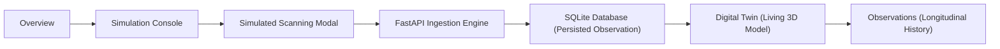

# POLYPULSE — The Living Lesion Digital Twin

**Digital Twin Challenge 2026 Submission**  
*Academic Research Prototype — Not Clinically Validated — Not a Medical Device*

---

> [!IMPORTANT]
> **REGULATORY CLAIMS NOTICE:**
> POLYPULSE is an academic software proof-of-concept developed to demonstrate longitudinal lesion tracking using patient-specific digital twins.
> - It is **NOT clinically validated** and is **NOT a medical device**.
> - It provides **NO independent diagnosis, malignancy scoring, or automated cancer detection**.
> - Continuous uterine ultrasound wearables are a **PROPOSED FUTURE CONCEPT** simulated entirely via software.

---

## 1. Product Overview & Architecture

POLYPULSE is a patient-specific digital-twin platform designed to track internal lesions longitudinally, beginning with endometrial polyps. The visual language is inspired by the **BioTrack Healthcare Dashboard Design** (light-mode default, #FFFFFF primary surface, #F7F6FA secondary surface, #24212D text, and #8B5CF6 violet accent), providing a focused, clutter-free user experience structured around four core sections:



### The 4 Core Application Sections:
1. **Overview (`/`):** Concise entry point displaying selected fictional patient, simulated device readiness, latest observation telemetry, interactive 3D mini digital twin preview, and prominent **Start Assessment** button.
2. **Simulation Console (`/simulation`):** The demonstration centerpiece with patient cohort selection, device status ("READY FOR SIMULATION"), configurable countdown presets (60s standard, 10s demo, 5s fast eval), live Canvas ultrasound B-mode sector visualization, 4-phase acoustic calibration stepper, progress ring, cancellation support, and automated backend ingestion.
3. **Digital Twin (`/twin`):** Full-screen interactive 3D procedural uterus (fundus, body, cervix, fallopian tubes, ovaries, and coronal cross-section plane revealing the endometrial cavity). Features a highlighted lesion mesh whose 3D ellipsoid dimensions scale dynamically from persisted observation data, camera orbit/pan/zoom/reset controls, view presets, and historical version timeline scrubber.
4. **Observations (`/observations`):** Chronological log of all recorded observations with dimensions, calculated ellipsoid volume, measurement confidence, provenance badges, and a side-by-side longitudinal differential comparison tool.

---

## 2. Core Workflow Sequence

The entire product revolves around one verifiable workflow:

$$\text{Select Patient} \longrightarrow \text{Device Ready} \longrightarrow \text{Start Assessment} \longrightarrow \text{Live Scanning} \longrightarrow \text{Processing} \longrightarrow \text{Persist Observation} \longrightarrow \text{Update Digital Twin} \longrightarrow \text{Compare History}$$

1. **Patient Selection:** Select between three seeded fictional patients with distinct trajectories:
   - **Elena Rostova (`MRN-2026-081`):** Stable trajectory.
   - **Amara Okafor (`MRN-2026-144`):** Gradual growth trajectory.
   - **Sofia Lindqvist (`MRN-2026-290`):** Rapid dimensional change.
2. **Device Preparation:** Simulated wearable status explicitly verified as `DEVICE STATUS: READY FOR SIMULATION`.
3. **Start Assessment:** Launches the focused `ScanningModal` with genuine countdown timer (using high-resolution `performance.now()`), avoiding browser interval drift.
4. **Live Scanning Visualization:** HTML5 Canvas renders a dynamic 70° sector B-mode ultrasound fan with radial acoustic sweep, echogenic cavity boundary, hyperechoic polyp reflection, and real-time calipers.
5. **Phase Progression:** Progresses smoothly through:
   - *Phase 1:* Transducer Acoustic Coupling & Initialization
   - *Phase 2:* Radial Acoustic Sector Beam Sweep
   - *Phase 3:* Hyperechoic Endometrial Margin & Boundary Segmentation
   - *Phase 4:* Bi-Axial Caliper Extraction & Volumetric Synthesis
6. **Processing Transition:** Automatically submits observation parameters to `/api/v1/simulation/ingest`.
7. **Persistence:** Backend persists `Observation`, computes derived volume via $V = (\pi/6) \cdot L \cdot W \cdot D$, calculates interval growth rate in $\text{mm/month}$, and creates an immutable `TwinStateVersion` (e.g. `v4`).
8. **Digital Twin Update:** The 3D model immediately updates to reflect the new lesion geometry.

---

## 3. Technology Stack

- **Frontend:** React 19, TypeScript, Vite, Tailwind CSS v4, React Router v7, React Three Fiber (R3F), Three.js, Lucide Icons, Vitest, React Testing Library.
- **Backend:** Python 3.13, FastAPI, SQLAlchemy 2, Pydantic v2, ReportLab, Pillow, Pytest.
- **Database:** SQLite (persisted to `polypulse.db` at project root).
- **Styling:** BioTrack tokens (#FFFFFF, #F7F6FA, #24212D, #716C7D, #8B5CF6, #F1EAFF, #E7E3EE).

---

## 4. Quickstart & Run Instructions

### Prerequisites
- Python 3.11+ (Python 3.13.5 tested)
- Node.js 18+ (Node v24.12.0 tested)

### Step 1: Install Dependencies
```powershell
# In project root
cd C:\Users\admin\.gemini\antigravity\scratch\polypulse

# Backend virtual environment
.\venv\Scripts\python -m pip install -r backend/requirements.txt

# Frontend dependencies
cd frontend
npm install
cd ..
```

### Step 2: Seed Demonstration Database
```powershell
.\venv\Scripts\python scripts/seed_data.py
```

### Step 3: Start Applications

**Terminal 1 (FastAPI Backend):**
```powershell
cd C:\Users\admin\.gemini\antigravity\scratch\polypulse\backend
..\venv\Scripts\python -m uvicorn app.main:app --host 127.0.0.1 --port 8000 --reload
```
*API Docs:* [http://127.0.0.1:8000/docs](http://127.0.0.1:8000/docs)  
*Health Check:* [http://127.0.0.1:8000/api/v1/health](http://127.0.0.1:8000/api/v1/health)

**Terminal 2 (React Vite Client):**
```powershell
cd C:\Users\admin\.gemini\antigravity\scratch\polypulse\frontend
npm run dev
```
*Web App:* [http://localhost:5173](http://localhost:5173)

---

## 5. Automated Tests

Run test suites across both layers:

```powershell
# Frontend Vitest Suite (11 tests: Theme, Provenance, Math Engine, Idempotency)
cd C:\Users\admin\.gemini\antigravity\scratch\polypulse\frontend
npm run test

# Backend Pytest Suite (10 tests: End-to-End Ingestion, Math, Reports, Auth, Idempotency)
cd C:\Users\admin\.gemini\antigravity\scratch\polypulse\backend
..\venv\Scripts\python -m pytest -v
```

---

## 6. Demonstration Script for Judges

1. **Launch App:** Open [http://localhost:5173](http://localhost:5173). Notice the clean light mode presentation, active patient card (Elena Rostova), and interactive 3D mini digital twin.
2. **Theme Switch:** Click the Sun/Moon toggle in the top bar. Notice instant theme change without page flash, persisting across reloads.
3. **Start Assessment:** Click **Start Assessment** on the Overview or navigate to **Simulation Console**.
4. **Execute Simulation:**
   - Select the **10s Demo** preset (or **5s Fast Eval**).
   - Click **Start Assessment (10s)**.
   - Observe the live ultrasound sector sweep, 4 acoustic calibration phases, and genuine countdown progress ring.
5. **Inspect Persistence:**
   - When the countdown finishes, observe the transition to `PROCESSING` and immediate persistence confirmation with new twin version `v4`.
   - Click **View in 3D Digital Twin**.
6. **Interact with Digital Twin:**
   - Orbit, zoom, and click **Cross-Section** to view the endometrial cavity and highlighted polyp.
   - Click previous versions (`State v1`, `State v2`, `State v3`) on the bottom timeline. Notice the 3D lesion scale and telemetry card update in real time.
7. **Compare History:**
   - Navigate to **Observations**.
   - Click **Compare Observations**.
   - Inspect the side-by-side card comparison showing delta length (+mm), delta volume (+mm³), and growth rate (mm/month).
