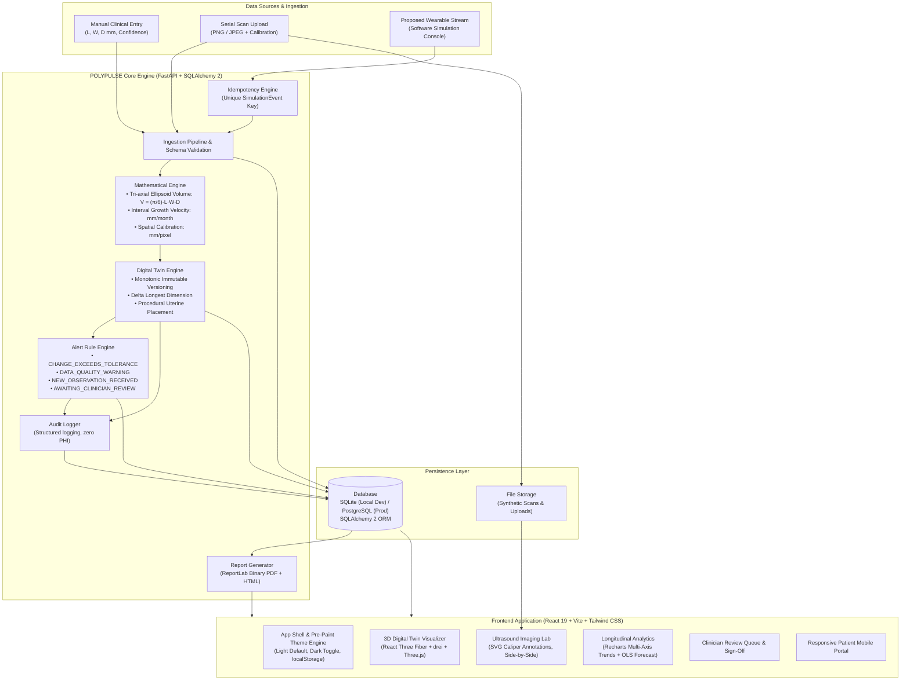

# POLYPULSE — System Architecture & Data Flow

*Happiest Health Digital Twin Challenge 2026*
*Research Prototype — Not Clinically Validated — Not a Medical Device*

---

## 1. System Overview

POLYPULSE is an end-to-end longitudinal digital twin application designed for the serial observation, dimensional analysis, spatial 3D visualization, and clinical governance of endometrial lesions (specifically uterine polyps).

The platform enforces strict computational integrity: numeric values are never fabricated in the presentation layer; every observation, measurement delta, and alert is derived from persisted database records.

---

## 2. High-Level Architecture Diagram

---

## 3. Data Class Classification & Provenance Tracking

POLYPULSE categorizes all information into four distinct data classes to prevent diagnostic misinterpretation:

| Data Class | Semantic Definition | Example Fields | Visual Identification |
| :--- | :--- | :--- | :--- |
| **OBSERVED** | Raw measured inputs directly captured via manual entry, file upload, or sensor stream. | `length_mm`, `width_mm`, `depth_mm`, `image_quality` | Blue Badge (`MANUAL`) or Amber Badge (`SIMULATED`) |
| **DERIVED** | Quantities computed exclusively via documented deterministic mathematical formulas. | `volume_mm3`, `growth_rate_mm_per_month`, `delta_length_mm` | Purple Badge (`DERIVED`) |
| **ILLUSTRATIVE** | Procedural 3D anatomical meshes rendered for spatial context; not patient-specific reconstructions. | Fundus, cervix, fallopian tubes, endometrial cavity | Slate Badge (`ILLUSTRATIVE`) + Mandatory Notice |
| **PREDICTION** | Experimental transparent statistical baselines with confidence intervals. | 30/60/90-day linear projections and uncertainty bounds | Rose Dashed Badge (`PREDICTED`) |

---

## 4. Processing Pipeline Execution Sequence

For every new serial observation (manual or simulated stream):

1. **Request Validation:** Validates schema bounds ($L > 0$, $W > 0$, $0.0 \le \text{confidence} \le 1.0$) and verifies patient existence.
2. **Idempotency Guard:** For simulated stream events, checks `SimulationEvent.idempotency_key`. Duplicate requests return the original committed state without creating duplicate records.
3. **Derived Computations:**
   - Evaluates ellipsoid volume: $V = \frac{\pi}{6} \cdot L \cdot W \cdot D$. If $D$ is missing, evaluates explicit assumption flag ($D = W$).
   - If $\ge 2$ observations exist, calculates interval growth rate: $\text{Rate} = \frac{L_{\text{current}} - L_{\text{previous}}}{\Delta t_{\text{days}}} \times 30.4375$ mm/month.
4. **Immutable Twin State Versioning:** Creates a new, monotonically incremented `TwinStateVersion` linked to its parent version. Existing versions are never modified or overwritten.
5. **Alert Rule Evaluation:**
   - Evaluates whether $\Delta L \ge \text{tolerance\_growth\_mm}$ (default: $1.0\text{ mm}$, demonstration threshold).
   - Checks confidence and quality thresholds.
   - Generates in-app alert records with trigger rules and explanations.
6. **Clinical Review Queue:** Appends a `PENDING` review record for clinician sign-off.
7. **Audit Logging:** Emits structured audit event recording timestamp, entity ID, and event type with patient-identifying data strictly scrubbed.
8. **Consistent Transaction Commit:** Atomic commit ensures either all artifacts persist or the database rolls back entirely.

---

## 5. Security & Demo Role-Based Access Control (RBAC)

- **Demonstration Security Notice:** Authentication utilizes JSON Web Tokens (JWT) signed with HMAC-SHA256. Intended for demonstration role isolation, not production HIPAA-certified clinical deployment.
- **Roles:**
  - `CLINICIAN`: Full cohort access, clinical review sign-off, patient creation.
  - `PATIENT`: Strictly restricted to their own linked medical record and non-diagnostic educational view.
  - `ADMIN`: System configuration, threshold customization, global audit review.
